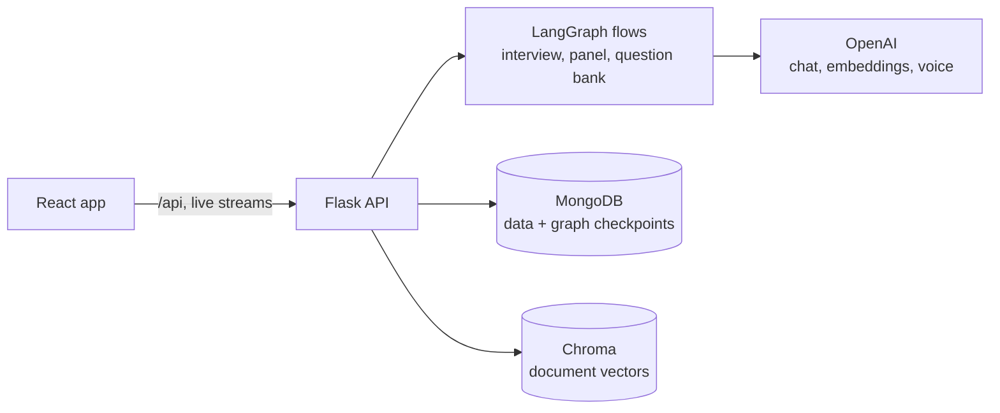

# SpAIder

An AI interview coach that practises with you the way real interviews happen: an interviewer who listens and
follows up, a panel that passes notes before it decides, a whiteboard and a coding room, and a drill that makes
you defend every line of your resume. Every score can be explained: the AI quotes your answer, and code checks
the quote before it counts.

## What it does

- **Mock interview**: Bella asks, listens, follows up when an answer leaves something out, and writes a report.
  Type your answers, or take it as a video call with a 3D interviewer, her own voice and live captions.
- **Panel interview**: two to four interviewers in a video-call grid. They introduce themselves, take turns,
  follow up on each other, pass private notes, and vote hire or no hire.
- **Resume grind**: finds every claim on your resume, asks you to prove each one, and shows the resume as a
  heatmap. Weak lines come back until you can defend them.
- **Question bank**: a team of agents writes questions from your JD and resume, and a judge checks them.
- **Whiteboard and coding rounds**: Bella watches your diagram or your code and reacts as you work.
- **Documents**: ask about your own PDFs and get answers with page numbers.
- **Stats, focus mode, evals and AI traces**: your streak and spider, a distraction guard, and tools that show
  and measure what the AI did.

## How it works



| Part | Built with |
|---|---|
| Frontend | React 19 + Vite (plain JavaScript), Excalidraw, CodeMirror + Pyodide, three.js |
| Backend | Flask (app factory + blueprints), gunicorn |
| AI | LangChain + LangGraph. Each interview is a graph saved in MongoDB, so it can pause for your answer and pick up again |
| Data | MongoDB through MongoEngine models, Chroma for document search |

More detail: [product requirements](docs/PRD.md) · [technical design](docs/TRD.md) · [UI design](docs/DESIGN.md) ·
[project map](docs/PROJECT_MAP.md) · [deployment](docs/DEPLOY.md)

## Run it locally

You need Python 3.12, Node 22, a MongoDB (local, or an Atlas connection string) and an OpenAI API key.

```bash
# backend, on port 5001
cd backend
python -m venv .venv && source .venv/bin/activate
pip install -r requirements.txt
cp .env.example .env          # add your OpenAI key and MongoDB address
python app.py

# frontend, on port 5173 (second terminal)
cd frontend
npm install
npm run dev
```

Open http://localhost:5173. The frontend sends every `/api` call to the backend, so there is nothing else to set up.

## Checks

```bash
cd backend
pip install -r requirements-dev.txt
ruff check .
pytest                    # fake AI, no API calls; needs a MongoDB (TEST_MONGO_URI, default localhost)
python -m evals.run       # measures the real AI judges against labelled cases (small API cost)

cd ../frontend
npm run lint && npm run build
```

The same lint, tests and build run on every push (`.github/workflows/ci.yml`). A push to `main` that passes them
deploys itself to the server ([how](docs/DEPLOY.md#3-updating-the-code)).

## Layout

```
backend/
  app.py        the Flask app: settings, MongoDB, every blueprint under /api
  models/       MongoEngine documents, one per collection
  routes/       HTTP only: check the request, call a service, return JSON
  services/     the logic, one folder per feature (interview, panel, resume_grind, question_bank, rag, ...)
  evals/        eval suites for the AI judges
  scripts/      developer tools (terminal interview, search demo, project map)
  tests/        pytest, with a fake AI model
frontend/src/
  pages/  components/  lib/api.js (every backend call)  styles/tokens.css (every colour)
deploy/         server setup, the gunicorn service, Caddy, update scripts
docs/
```
