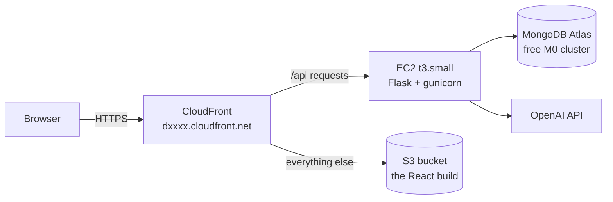
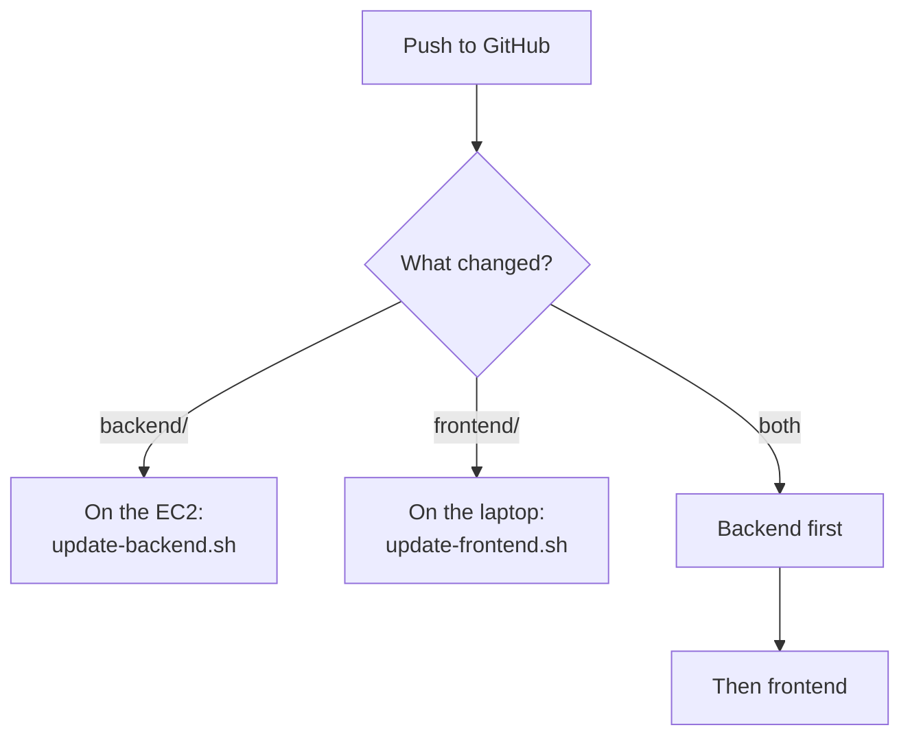

# Deploying SpAIder on AWS

This guide puts SpAIder online for testing: about **$7 for 10 days** (Mumbai region).
First the big picture, then every step in order.

## 1. The big picture



| Piece | What it does | Why this one |
|---|---|---|
| **CloudFront** | The front door. One HTTPS address for the whole app. | The microphone and camera only work on HTTPS, and CloudFront gives HTTPS for free, without buying a domain. |
| **S3** | Holds the built React app (plain files). | Files don't need a server. S3 + CloudFront is the standard way to host a website on AWS. |
| **EC2** | Runs the Flask backend. | It needs a real computer: Python, LangGraph, the Chroma folder, background threads. |
| **Elastic IP** | A fixed address for the EC2. | Without it, the address changes every time you stop and start the server, and CloudFront would lose it. |
| **MongoDB Atlas** | The database. | Free forever (M0), and in the same region (Mumbai), so it's fast. |

Because the browser only ever talks to CloudFront, the page and `/api` share one address: no CORS setup needed.

## 2. The steps, in order

| # | Step | Where | Time |
|---|---|---|---|
| 1 | Make the AWS account safe | AWS console | 10 min |
| 2 | Push the code to GitHub | Laptop | 5 min |
| 3 | Create the EC2 and its Elastic IP | AWS console | 15 min |
| 4 | Let the EC2 into Atlas | Atlas | 2 min |
| 5 | Set up the server | SSH into the EC2 | 15 min |
| 6 | Create the S3 bucket and upload the website | AWS console + laptop | 10 min |
| 7 | Create the CloudFront distribution | AWS console | 15 min |
| 8 | Test everything | Browser | 10 min |
| 9 | Add a password before sharing the link | (the security step) | |

Use the **Asia Pacific (Mumbai) ap-south-1** region for everything (top right of the AWS console).

---

### Step 1. Make the AWS account safe

1. **MFA on the root user:** account menu (top right) → Security credentials → Assign MFA device.
2. **A budget alert:** Billing and Cost Management → Budgets → Create budget → *Monthly cost budget* → $10 → your email.
3. **A daily user instead of root:** IAM → Users → Create user (for example `dev-admin`), allow console access,
   attach the policy `AdministratorAccess`. Sign in with this user from now on. Root is only for billing and emergencies.

### Step 2. Push the code to GitHub

1. On github.com: **New repository** → name `spaider` → **Public** → don't add a README, .gitignore or licence
   (the code already has them).
2. GitHub wants a token, not your password, when you push. The easiest way:
   ```bash
   brew install gh
   gh auth login          # choose GitHub.com, HTTPS, login with a web browser
   ```
3. Push:
   ```bash
   cd ~/Practice/interview-coach
   git remote add origin https://github.com/<your-username>/spaider.git
   git push -u origin main
   ```
4. In the repo: **Settings → Advanced Security** → turn on **Secret scanning** and **Push protection**
   (free for public repos). GitHub then blocks any push that contains a key.

### Step 3. Create the EC2 and its Elastic IP

**EC2 → Launch instance:**

| Setting | Value |
|---|---|
| Name | `spaider-backend` |
| Image (AMI) | Ubuntu Server 24.04 LTS, 64-bit (x86) |
| Instance type | `t3.small` (2 vCPU, 2 GB) |
| Key pair | Create new → `spaider-key`, type RSA, `.pem`. Save it as `~/.ssh/spaider-key.pem` |
| Network settings | Create security group `spaider-backend-sg`. Allow SSH from **My IP** only. Untick HTTP/HTTPS. |
| Storage | 20 GiB, gp3 |

**Then:**

1. **Open port 8000 to CloudFront only.** EC2 → Security groups → `spaider-backend-sg` → Edit inbound rules → Add rule:
   Type *Custom TCP*, Port `8000`, Source: start typing `cloudfront` and pick the prefix list
   **`com.amazonaws.global.cloudfront.origin-facing`**. Now only CloudFront can reach the backend; nobody can skip it.
2. **Elastic IP:** EC2 → Elastic IPs → Allocate → then Actions → Associate → pick `spaider-backend`.
3. Open the instance and copy two things:
   - **Elastic IP** (like `13.233.10.20`): for SSH and for Atlas.
   - **Public IPv4 DNS** (like `ec2-13-233-10-20.ap-south-1.compute.amazonaws.com`): for CloudFront.

### Step 4. Let the EC2 into Atlas

Atlas → **Security → Network Access → Add IP Address** → the Elastic IP → Confirm.
(Your laptop's IP is already there from before.)

### Step 5. Set up the server

On your laptop:

```bash
chmod 400 ~/.ssh/spaider-key.pem       # ssh refuses a key file that others can read
ssh -i ~/.ssh/spaider-key.pem ubuntu@<ELASTIC_IP>
```

Now you are on the server:

```bash
curl -fsSL https://raw.githubusercontent.com/<your-username>/spaider/main/deploy/setup-server.sh -o setup-server.sh
bash setup-server.sh https://github.com/<your-username>/spaider.git
```

[deploy/setup-server.sh](../deploy/setup-server.sh) installs Python and git, adds 2 GB of swap (memory on disk, so
installing on a 2 GB server can't run out), clones the code, installs the Python packages and registers the
service [deploy/spaider.service](../deploy/spaider.service).

Then create the server's `.env`. Type it in yourself; it never goes into git:

```bash
nano ~/spaider/backend/.env
```

```
OPENAI_API_KEY=sk-...
MODEL=openai:gpt-6-luna
EMBEDDING_MODEL=openai:text-embedding-3-small
MONGO_URI=mongodb+srv://...      # the Atlas connection string
MONGO_DB=interview_coach
```

(Save in nano: Ctrl+O, Enter, Ctrl+X.)

```bash
chmod 600 ~/spaider/backend/.env       # only you can read it
sudo systemctl start spaider
curl localhost:8000/api/health         # {"mongo":"ok","status":"ok"}
```

Useful later: `sudo systemctl status spaider` (is it running?) and `sudo journalctl -u spaider -f` (its live log).

### Step 6. Create the S3 bucket and upload the website

1. **S3 → Create bucket:** name `spaider-site-<some digits>` (bucket names are unique across all of AWS), region Mumbai,
   **keep "Block all public access" on.** Only CloudFront will read it.
2. Build the website on your laptop:
   ```bash
   cd ~/Practice/interview-coach/frontend
   npm ci
   npm run build                       # makes frontend/dist
   ```
3. First upload by hand: open the bucket → **Upload** → drag in **everything inside** `frontend/dist`
   (`index.html`, `assets/`, `avatars/` and the rest, not the `dist` folder itself) → Upload.
   Later updates use the script in section 3.

### Step 7. Create the CloudFront distribution

**CloudFront → Create distribution.** If it asks for a pricing plan, pick **Free** (or pay-as-you-go, which also
costs about $0 at our usage).

The first origin is the website:

| Setting | Value |
|---|---|
| Origin | the S3 bucket |
| Origin access | **Origin access control (recommended)** → create a new one. Let the console update the bucket policy (or copy the policy it shows into the bucket's Permissions → Bucket policy). |
| Viewer protocol policy | Redirect HTTP to HTTPS |
| Cache policy | CachingOptimized (the default) |
| Web Application Firewall (WAF) | Skip for now (it costs extra unless your plan includes it) |
| Default root object | `index.html` |

After it is created, add the backend.

**Origins → Create origin:**

| Setting | Value |
|---|---|
| Origin domain | the EC2's **Public IPv4 DNS** (not the IP: CloudFront needs a name) |
| Protocol | HTTP only, port `8000` |
| Response timeout | `60` seconds (the longest wait between two pieces of a live stream) |
| Name | `ec2-api` |

**Behaviors → Create behavior:**

| Setting | Value |
|---|---|
| Path pattern | `/api/*` |
| Origin | `ec2-api` |
| Viewer protocol policy | Redirect HTTP to HTTPS |
| Allowed HTTP methods | GET, HEAD, OPTIONS, PUT, POST, PATCH, DELETE |
| Cache policy | **CachingDisabled** (every API answer is fresh) |
| Origin request policy | **AllViewerExceptHostHeader** (passes the body, headers and query to Flask) |

Wait until the status says **Deployed** (about 5 minutes), then open the **Distribution domain name**:
`https://dxxxxxxxxxxxx.cloudfront.net`.

### Step 8. Test everything

- [ ] The page loads, and the sidebar says *Backend online* and *MongoDB connected*.
- [ ] A text interview: the live steps appear while grading, and the X-ray opens.
- [ ] A voice call: the browser asks for the microphone (this only works because the address is HTTPS).
- [ ] Upload a small PDF and ask a question: the answer arrives word by word.
- [ ] A question bank finishes.

If `/api` calls fail: is the service running (`sudo systemctl status spaider`)? Is port 8000 open to the
CloudFront prefix list? Is the Elastic IP in Atlas's Network Access?

### Step 9. Before sharing the link

The app has no login, so anyone with the link could use your OpenAI key. Before sharing it, add a username and
password to the whole site with a small CloudFront Function. That is the first part of the security step.

---

## 3. Updating the code

Always push to GitHub first. Then deploy only the side that changed:



**Backend** ([deploy/update-backend.sh](../deploy/update-backend.sh)): pulls the code, installs new packages,
restarts the service, and waits until `/api/health` answers.

```bash
ssh -i ~/.ssh/spaider-key.pem ubuntu@<ELASTIC_IP> 'bash ~/spaider/deploy/update-backend.sh'
```

**Frontend** ([deploy/update-frontend.sh](../deploy/update-frontend.sh)): builds, uploads to S3, and tells
CloudFront to drop its old copies.

```bash
SITE_BUCKET=spaider-site-1234 DISTRIBUTION_ID=E2ABCDEF123 bash deploy/update-frontend.sh
```

It needs the AWS CLI on your laptop, logged in as a user that may only do this job:

1. `brew install awscli`
2. IAM → Users → Create user `spaider-deployer` (no console access) → Attach policies directly → Create policy → JSON:
   ```json
   {
     "Version": "2012-10-17",
     "Statement": [
       { "Effect": "Allow", "Action": "s3:ListBucket", "Resource": "arn:aws:s3:::SITE_BUCKET" },
       { "Effect": "Allow", "Action": ["s3:GetObject", "s3:PutObject", "s3:DeleteObject"], "Resource": "arn:aws:s3:::SITE_BUCKET/*" },
       { "Effect": "Allow", "Action": "cloudfront:CreateInvalidation", "Resource": "arn:aws:cloudfront::ACCOUNT_ID:distribution/DISTRIBUTION_ID" }
     ]
   }
   ```
   (Put in your bucket name, 12-digit account ID and distribution ID.)
3. That user → Security credentials → Create access key → *Command Line Interface* → then on the laptop:
   `aws configure` (paste the two keys, region `ap-south-1`).

**Why backend first when both change:** the new page may call a new API route. If the page went live first, it
would call a route that doesn't exist yet. Keep old routes working until the new page is live (like `/answer` next
to `/answer/live`).

**Next:** CI/CD. GitHub Actions will run these same two scripts for you after every merge, once you click Approve,
using short-lived credentials (OIDC) instead of the access key above.

## 4. Stopping, starting and cleaning up

- **Stop the EC2 when you're not testing:** EC2 → Instance state → Stop. The Elastic IP stays, so CloudFront still
  finds it after Start, and the service starts by itself at boot. While it's stopped, the page says
  *Can't reach the backend*. A stopped server still costs about $0.15 a day (disk + Elastic IP).
- **At the end, remove everything** (in this order):
  1. CloudFront: Disable the distribution, wait, then Delete.
  2. S3: Empty the bucket, then Delete it.
  3. EC2: Terminate the instance (this deletes its disk too).
  4. **Elastic IP: Release it.** An Elastic IP that isn't attached keeps costing money.
  5. IAM: delete the `spaider-deployer` access key.

## 5. Cost for 10 days

| Item | Running all the time | Stopped 16 hours a day |
|---|---|---|
| EC2 t3.small ($0.0224/hour) | $5.40 | $1.80 |
| 20 GB disk (also while stopped) | about $0.60 | about $0.60 |
| Elastic IP ($0.005/hour) | $1.20 | $1.20 |
| S3 (a few hundred MB) | under $0.05 | under $0.05 |
| CloudFront and data out | $0 (free allowance) | $0 |
| **Total** | **about $7** | **about $3.70** |

OpenAI usage is billed by OpenAI, separately. Set a monthly limit in the OpenAI dashboard.
