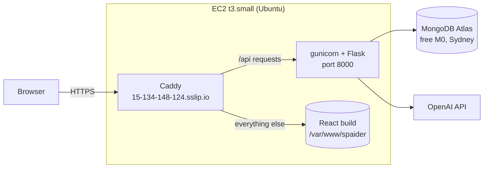
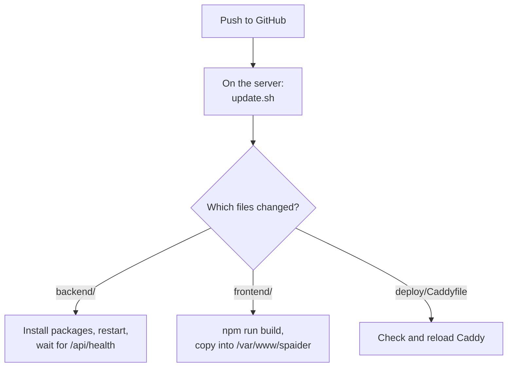

# Deploying SpAIder on AWS

This guide puts SpAIder online on one small AWS server: about **$8 for 10 days** (Sydney region).
First the big picture, then every step in order, then how to update the code.

## 1. The big picture



| Piece | What it does |
|---|---|
| **EC2** | One Linux server that runs everything below. |
| **Elastic IP** | A fixed address (`15.134.148.124`), so the address survives a stop and start. |
| **Caddy** | The front door: HTTPS, the site password, the website files, and passing `/api` calls to Flask. |
| **gunicorn + Flask** | The backend. gunicorn is the production web server for Flask. |
| **MongoDB Atlas** | The database. Free forever (M0), in the same region as the EC2, so it's fast. |

### What Caddy is

Caddy is a web server, like nginx, that does four jobs here with a 25-line settings file
([deploy/Caddyfile](../deploy/Caddyfile)):

1. **HTTPS, by itself.** It asks Let's Encrypt (a free certificate authority) for a certificate, proves it controls the
   name by answering a check on port 80, and renews it every couple of months. The microphone and camera only work on
   HTTPS pages, so voice mode needs this.
2. **A password for the whole site** (`basicauth`), because the app has no login and spends OpenAI credits.
3. **The website:** the built React files in `/var/www/spaider`.
4. **A reverse proxy:** every `/api/...` request is passed on to gunicorn on port 8000 of the same server, and each live
   message (Server-Sent Events) is passed on at once.

**Why the strange address?** A certificate needs a *name*, not just an IP, and we didn't buy a domain.
`sslip.io` is a free DNS service: `15-134-148-124.sslip.io` simply points to `15.134.148.124`.

Because the browser only ever talks to Caddy, the page and `/api` share one address: no CORS setup needed.

## 2. The steps, in order

| # | Step | Where |
|---|---|---|
| 1 | Make the AWS account safe | AWS console |
| 2 | Push the code to GitHub | Laptop |
| 3 | Create the EC2, its Elastic IP and firewall rules | AWS console |
| 4 | Let the EC2 into Atlas | Atlas |
| 5 | Set up the server (Python, the backend service) | SSH |
| 6 | Set up Caddy (HTTPS, password, website) | SSH |
| 7 | Test everything | Browser |

**Region: Asia Pacific (Sydney) ap-southeast-2.** On the AWS free plan's "projects" setup, a project is fixed to one
region (ours is Sydney) and the console shows no region menu. Users in India add about 0.15 s per request; each AI step
takes seconds anyway.

---

### Step 1. Make the AWS account safe

- **MFA** on the account you sign in with. With an AWS Builder ID: https://profile.aws.amazon.com → Security →
  MFA devices → Register device.
- **Spending:** the free plan has spend limits and can't charge more than its credits. Don't click "Upgrade account":
  that removes the limits.

### Step 2. Push the code to GitHub

```bash
brew install gh
gh auth login                                  # GitHub.com → HTTPS → login with a web browser
cd ~/Practice/interview-coach
gh repo create spaider --public --source=. --remote=origin --push
```

Then turn on **Secret scanning** and **Push protection** (repo Settings → Advanced Security). GitHub then blocks any
push that contains a key.

### Step 3. Create the EC2, its Elastic IP and firewall rules

**EC2 → Launch instance** (choose *Launch without a walkthrough*):

| Setting | Value |
|---|---|
| Name | `spaider-backend` |
| Image | **Ubuntu Server 24.04 LTS**, 64-bit (x86). Not 26.04: 24.04 comes with Python 3.12, which the code is tested on. |
| Instance type | `t3.small` (2 vCPU, 2 GB) |
| Key pair | Create new → `spaider-key`, RSA, `.pem` |
| Network settings → Edit | New security group `spaider-backend-sg`. SSH, source **Custom**: your public **IPv4** + `/32` (find it with `curl -4 https://checkip.amazonaws.com`). "My IP" may pick your IPv6 address, which won't work: the server only has IPv4. |
| Storage | 20 GiB, gp3 |

Then:

1. **Elastic IP:** EC2 → Elastic IPs → Allocate → Actions → Associate → `spaider-backend`.
2. **Firewall for the website:** Security groups → `spaider-backend-sg` → Edit inbound rules → add
   **HTTP (80)** and **HTTPS (443)**, source **Anywhere-IPv4**. Port 8000 stays closed: only Caddy, on the same
   server, talks to it.
3. **The key file**, on your laptop (it doesn't touch your other SSH keys):
   ```bash
   mkdir -p ~/spaider-keys
   mv ~/Downloads/spaider-key.pem ~/spaider-keys/
   chmod 400 ~/spaider-keys/spaider-key.pem
   ```

### Step 4. Let the EC2 into Atlas

Atlas → **Security → Network Access → Add IP Address** → `15.134.148.124` → **untick "This entry is temporary"**
→ Confirm. (A temporary entry deletes itself after a few hours, and the backend then loses the database.)

### Step 5. Set up the server

```bash
ssh -i ~/spaider-keys/spaider-key.pem -o IdentitiesOnly=yes ubuntu@15.134.148.124
```

`IdentitiesOnly=yes` makes SSH offer only this key, never your other ones. On the server:

```bash
tmux new -s setup                              # keeps running even if your connection drops
curl -fsSL https://raw.githubusercontent.com/shreshthdeveloper/spaider/main/deploy/setup-server.sh -o setup-server.sh
bash setup-server.sh https://github.com/shreshthdeveloper/spaider.git
```

[deploy/setup-server.sh](../deploy/setup-server.sh) installs Python, git and Node.js, adds 2 GB of swap (memory on
disk), clones the code, installs the Python packages and registers the backend as a service
([deploy/spaider.service](../deploy/spaider.service)).

Then create the server's `.env`. Type it yourself; it never goes into git:

```bash
nano ~/spaider/backend/.env
```

```
OPENAI_API_KEY=sk-...
MODEL=openai:gpt-6-luna
EMBEDDING_MODEL=openai:text-embedding-3-small
MONGO_URI=mongodb+srv://...
MONGO_DB=interview_coach
```

(Save in nano: Ctrl+O, Enter, Ctrl+X.)

```bash
chmod 600 ~/spaider/backend/.env               # only you can read it
sudo systemctl start spaider
curl localhost:8000/api/health                 # {"mongo":"ok","status":"ok"}
```

The backend reads `.env` only when it starts: after editing it, run `sudo systemctl restart spaider`.

### Step 6. Set up Caddy

```bash
bash ~/spaider/deploy/setup-caddy.sh           # asks you to choose the site's username and password
bash ~/spaider/deploy/update.sh all            # builds the React app and publishes it
```

[deploy/setup-caddy.sh](../deploy/setup-caddy.sh) installs Caddy, stores only a hash of the site password (in
`/etc/caddy/site-password.caddy`, never in git), and loads [deploy/Caddyfile](../deploy/Caddyfile).

### Step 7. Test everything

Open **https://15-134-148-124.sslip.io** and log in with the site username and password.

- [ ] The sidebar says *Backend online* and *MongoDB connected*.
- [ ] A text interview: the live steps appear while grading, and the X-ray opens.
- [ ] A voice call: the browser asks for the microphone, and the captions keep pace with the voice.
- [ ] Upload a small PDF and ask a question: the answer arrives word by word.
- [ ] A question bank finishes.

---

## 3. Updating the code

Push from the laptop, then run **one script on the server**. It pulls the code and updates only the parts that
changed: the backend (packages + restart + health check), the frontend (build + publish) and Caddy's settings.



**From your laptop, one command** ([deploy/ship.sh](../deploy/ship.sh)): commit, then

```bash
bash deploy/ship.sh          # push to GitHub, then the server runs update.sh
bash deploy/ship.sh all      # the same, but rebuild and restart everything
```

It refuses to run with uncommitted changes, or from a branch other than `main`: the server always runs exactly what
is on GitHub.

Or, already logged in on the server: `bash ~/spaider/deploy/update.sh` (add `all` to rebuild everything).

**A quick website-only copy** (no git, no server build) also works, after `npm run build` on the laptop:

```bash
rsync -av --delete -e "ssh -i ~/spaider-keys/spaider-key.pem -o IdentitiesOnly=yes" frontend/dist/ ubuntu@15.134.148.124:/var/www/spaider/
```

It is handy for trying a change, but the live site then differs from GitHub until the next `ship.sh`, which rebuilds
from GitHub and replaces it.

**When a change touches both sides,** the script restarts the backend before it publishes the new page, so the new
page never calls an API route that isn't live yet. Keep old routes working until the new page is out (like `/answer`
next to `/answer/live`).

**Next: CI/CD.** GitHub Actions will run this same script after every merge, once you click Approve.

## 4. Later: CloudFront

The first plan was CloudFront (HTTPS and a CDN) in front of an S3 bucket with the website, plus the EC2 for `/api`.
New AWS accounts must be verified by AWS Support before they can create CloudFront distributions, so we started with
Caddy. Once the account is verified, CloudFront can sit in front of Caddy (or replace it), and the S3 bucket
`spaider-site` will hold the uploaded PDFs.

## 5. Stopping, starting and cleaning up

- **Stop the EC2 when you're not testing:** EC2 → Instance state → Stop. The Elastic IP stays, and the backend and
  Caddy start by themselves at boot. A stopped server still costs about $0.15 a day (disk + Elastic IP).
- **At the end, remove everything:**
  1. EC2: Terminate the instance (this deletes its disk too).
  2. **Elastic IP: Release it.** An Elastic IP that isn't attached keeps costing money.
  3. S3: Empty the bucket, then Delete it.
  4. Atlas: remove the EC2's IP from Network Access.

## 6. Cost for 10 days

| Item | Running all the time | Stopped 16 hours a day |
|---|---|---|
| EC2 t3.small ($0.0264/hour) | $6.35 | $2.10 |
| 20 GB disk (also while stopped) | about $0.65 | about $0.65 |
| Elastic IP ($0.005/hour) | $1.20 | $1.20 |
| S3 (a few MB) | under $0.01 | under $0.01 |
| **Total** | **about $8.20** | **about $4** |

OpenAI usage is billed by OpenAI, separately. Set a monthly limit in the OpenAI dashboard.

## 7. When something goes wrong

| What you see | Usual cause | Fix |
|---|---|---|
| `"mongo":"down"`, or `SSL handshake failed … tlsv1 alert internal error` | Atlas doesn't allow the server's IP | Atlas → Network Access: add `15.134.148.124`, not temporary |
| `ssh` hangs, then times out | Your laptop's IP changed | Security group → edit the SSH rule with your new IPv4 `/32` |
| The page says *Can't reach the backend* | The backend isn't running | `sudo systemctl status spaider`, then `sudo journalctl -u spaider -n 40 --no-pager` |
| The browser warns about the certificate | Caddy couldn't get one (ports 80/443 closed?) | `sudo journalctl -u caddy -n 30 --no-pager` |
| A change in `.env` has no effect | The backend reads it only at start | `sudo systemctl restart spaider` |
