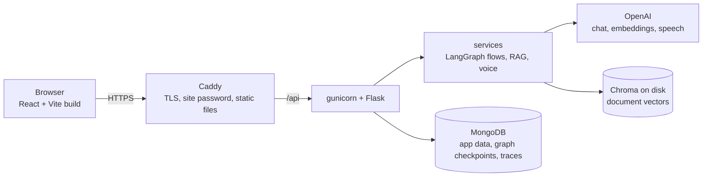

# Technical design: SpAIder

What the system is made of, how the AI parts work, and why. For every route and function, see
[PROJECT_MAP.md](PROJECT_MAP.md); for the server, [DEPLOY.md](DEPLOY.md).

## 1. Architecture



- **One backend process** (gunicorn, 1 worker, 8 threads, 300 s timeout). Threads serve live streams and
  background work (question bank runs, voice preparation); one worker keeps in-process caches (the compiled
  graphs, the voice cache) simple. See section 10 for scaling.
- **The browser talks only to `/api`.** In development Vite proxies it to Flask; in production Caddy does. The
  page and the API share one origin, so there is no CORS.

## 2. Backend structure

| Layer | Folder | Rule |
|---|---|---|
| App | `app.py`, `db.py` | `create_app()` loads `.env`, sets the upload limit (10 MB), connects MongoDB, registers one blueprint per file under `/api` |
| Routes | `routes/` | HTTP only: read and check the request, call a service, return JSON. Errors are `{"error": "..."}` with 400 (bad input), 404 (not found), 409 (already finished), 503 (AI voice unavailable) |
| Services | `services/` | All logic. A feature with an AI flow gets its own folder: `prompts.py`, `schemas.py` (structured output), `state.py`, `nodes.py`, `graph.py` |
| Models | `models/` | MongoEngine documents, one per collection, each with a `find_x(id)` helper that returns `None` for a bad id |

Code is written to be read: plain loops and named helpers, a docstring on every function (the project map is
built from them), no clever one-liners.

## 3. Data

| Collection | Model | Holds |
|---|---|---|
| `interviews` | `Interview` | Settings, status, overall score, source (`"resume"` for a Resume grind) |
| `panel_interviews` | `PanelInterview` | Inputs, panelists, settings, mode, decision, score |
| `resumes` | `Resume` | The cleaned text and lines, every claim with its colour, schedule and attempts, version changes, grinds |
| `question_banks` | `QuestionBank` | Inputs, pipeline steps, plan, final and dropped questions, practice history |
| `whiteboard_sessions`, `coding_sessions` | | The board or code, the conversation, the report |
| `documents` | `UploadedDocument` | File name, pages, chunk count |
| `chat_sessions` | `ChatSession` | Practice chat messages |
| `eval_runs` | `EvalRun` | Every eval run with its cases and metrics |
| `llm_traces` | `LLMTrace` | Every model call; deleted automatically after 7 days (TTL index) |
| `checkpoints`, `checkpoint_writes` | LangGraph | The state of every interview, panel and bank graph after each step |

A graph's state lives in its checkpoints; the app's own document stores only what lists and stats need. The
checkpoint thread id is the document's id, so "carry on interview X" is a single lookup.

Chroma keeps document chunks in `backend/chroma/` (collection `document_chunks`, filtered by document id).
Uploaded PDFs are kept in `backend/uploads/`. Spoken audio is cached in `backend/tts_cache/`. None of these are
in git.

## 4. AI design

### 4.1 Models
All configured in `.env` and created in one place:

| Use | Setting | Where |
|---|---|---|
| Every chat and structured call | `MODEL` (`openai:gpt-6-luna`) | `services/llm.py` `get_model()` |
| Embeddings | `EMBEDDING_MODEL` (`openai:text-embedding-3-small`) | `services/llm.py` `get_embeddings()` |
| Speech | `gpt-4o-mini-tts`; Bella and five panel voices | `services/voice.py` |
| Transcription | `gpt-transcribe` | `services/voice.py` |

### 4.2 Rules every AI step follows
- **Structured output** (Pydantic schemas) for anything code reads. No parsing of free text.
- **Code decides, the model describes.** Scores, routing, vote counts and schedules are plain code. The model
  says which key points an answer covers and quotes the words; code checks every quote against the answer
  before a point counts. A model can't hand out credit that isn't in the answer.
- **User text is data.** Answers, resumes and JDs are wrapped in tags, and every prompt that reads them says to
  ignore instructions inside them.
- **Quotes from inputs are verified.** Resume claims and question bank "based on" quotes must really appear in
  the resume, JD or documents, or they are dropped.

### 4.3 Mock interview (LangGraph)

```
START → plan_questions → ask ⇄ (your answer) → grade → route:
                                                 follow_up → ask
                                                 next_question → ask
                                                 write_report → END
```

`ask` pauses the graph with `interrupt()`; each answer is a new request that resumes it with
`Command(resume=...)`. The MongoDB checkpointer saves the state after every node, so a failed step is retried with
`invoke(None)` and the answer is never lost. `route` is code: a follow-up only when the score is under 4 with key
points missed and follow-ups remain. The overall score averages main questions only. The first question carries
Bella's fixed greeting. The X-ray reads `get_state_history()` and replays each routing decision with its reason.

### 4.4 Panel interview (LangGraph, supervisor pattern)

```
START → brief → ask ⇄ (your answer) → grade → listen × each panelist (parallel) → moderator
                 ↑                                                                  │
                 └──── a follow-up or the next main question ───────────────────────┤
                                       every question asked, or End → verdict × each panelist (parallel) → debrief → END
```

- **brief**: one call writes each panelist's questions on their own focus, with a spare each.
- **grade**: the same judge as the mock interview (`check_answer`).
- **listen**: one `Send` per panelist; all run at once. Each writes a private note and may request a follow-up.
  `notes`, `transcript`, `results`, `decisions` and `verdicts` use add-reducers, so parallel writes are all kept.
- **moderator**: code lists what is allowed (follow-up budget, whose turn it is, whether questions remain). The AI
  picks only when a follow-up is possible, and its pick is checked. A new main question always goes to the
  panelist who has asked the fewest.
- **debrief**: code counts the votes (hire needs at least half); the AI writes the summary.
- Introductions are fixed text per panelist, so they cost nothing and can be voiced ahead of time.

### 4.5 Resume grind
No graph of its own: two single calls (find claims, write questions) and the mock interview graph. Claims are
copied word for word and checked against the resume; their lines are located (a claim may wrap over three
lines). A grind starts an interview with `source="resume"`; when the resume is next opened, finished grinds are
scored onto their claims in order (main answer → claim, follow-ups kept inside the attempt). New versions are
matched to old claims by exact words, then by similarity (`difflib`, ≥ 0.6). Contact details are removed with
regular expressions before storage.

### 4.6 Question bank (LangGraph, parallel agents with human review)

```
START → coordinator → review_plan → agent × N (parallel, may search documents) → judge → review_verdict
                                                                     revise (once) → judge ┘   → assemble → END
```

Runs in a background thread; the page polls its progress. In review mode `review_plan` and `review_verdict`
pause with `interrupt()` for the candidate. The judge scores relevance, level, clarity and answer (1 to 5);
a 2 or lower on any of them drops the question, and it may drop at most 40%.

### 4.7 Documents (RAG)
pypdf → `RecursiveCharacterTextSplitter` (800 characters, 120 overlap) → embeddings → Chroma. A question
retrieves the top 5 chunks of that document; chunks under 0.3 relevance are ignored, and with none left the
answer is "I couldn't find this in the document" without calling the model. Answers cite pages and stream word
by word. The 3D map clusters the chunk vectors (k-means) for display.

### 4.8 Whiteboard and coding
The Excalidraw scene is turned into a short text description (boxes, labels, arrows, in reading order) and sent
with a PNG of the board, so the model sees both structure and layout. Coding tests run in the browser in a
Pyodide web worker; the backend receives the code and the results and never executes user code.

### 4.9 Voice
Speech is cached on disk by a hash of model, voice, style and text, so each sentence is paid for once. Upcoming
planned questions and introductions are voiced in a background thread. Panel voices come from a fixed allow-list.
Captions use the real audio length, so they keep pace with the voice; the 3D avatar (TalkingHead, CC0 model) uses
the same timing for lip-sync.

### 4.10 Live updates
Server-Sent Events over a POST (read with `fetch` and a stream reader). Graph runs stream
`stream_mode="tasks"`: a `start` and `finish` event per step (with a task id, so parallel panelist steps can be
matched), then `done` with the new state. An error mid-stream is sent as an `error` event, because the 200 status
has already gone out.

## 5. API

JSON in and out, all under `/api`. The full list, with one line per route, is in
[PROJECT_MAP.md](PROJECT_MAP.md#api-routes). Long AI work streams (`.../answer/live`, `.../ask/live`); everything
else is a plain request.

## 6. Security and privacy

| Area | What we do |
|---|---|
| Secrets | Only in the server's `.env` (never committed; `.env.example` holds placeholders). GitHub secret scanning and push protection are on |
| Access | Caddy puts the whole site behind a password (bcrypt hash on the server) and serves HTTPS. SSH only from the owner's IP |
| Deployment | No server key in GitHub: a runner on the server pulls deploy jobs; outside contributors' workflows need approval |
| Prompt injection | User text wrapped in tags and marked as data; scores and decisions computed by code from verified quotes |
| Uploads | The first bytes must be `%PDF-`; 10 MB request limit; text length limits on every field |
| Personal data | Emails, phone numbers and links removed from resumes before storage or AI; camera video stays in the browser |
| Inputs to paid APIs | Voices from an allow-list; text length limits on speech |

Known gaps: no per-user accounts and no rate limiting. Both are needed before any wider sharing.

## 7. Observability

- **AI traces**: a LangChain callback (`services/tracing.py`) saves every model call (prompt, output, tokens,
  time, error) to `llm_traces`; the Traces page searches them.
- **Interview X-ray**: every step of an interview graph, from its checkpoints.
- **Logs**: gunicorn and Flask log to journald on the server (`journalctl -u spaider`).

## 8. Quality

| Check | Command | Covers |
|---|---|---|
| Unit and API tests | `pytest` | Mock interview, Resume grind, panel and voice routes, with a fake model and a test database; no API calls |
| Python lint | `ruff check .` | Style, unused names, import order |
| Frontend lint and build | `npm run lint`, `npm run build` | Oxlint, and a production build |
| Evals | `python -m evals.run` | The real grader and bank judge against labelled cases, with the targets in the PRD |

CI (`.github/workflows/ci.yml`) runs the tests and both lints, and builds the frontend, on every push and pull
request. On a push to `main` it then deploys (section 9).

## 9. Deployment

One EC2 instance (Ubuntu 24.04, t3.small) runs Caddy and the gunicorn service; MongoDB is Atlas.

**Continuous deployment:** a push to `main` runs the checks on GitHub; when both pass, the `deploy` job runs on a
self-hosted GitHub runner on the server itself and calls `deploy/update.sh`. The runner only connects out to
GitHub, so SSH stays closed to everyone but the owner's IP and GitHub holds no server key. Workflows from outside
contributors' pull requests need the owner's approval, so nobody else's code can reach the runner. One deploy runs
at a time.

`update.sh` updates only the parts whose files changed: backend (packages, restart, wait for `/api/health`),
frontend (build, publish) or Caddy (validate, reload). `deploy/ship.sh` does the same by hand over SSH. Details and
costs: [DEPLOY.md](DEPLOY.md).

## 10. Limits and next steps

| Today | Why it's fine now | Next |
|---|---|---|
| One gunicorn worker | One user; threads cover streams and background runs | Move background runs to a queue (SQS + a worker), then add workers |
| Chroma on the server's disk | One server | Atlas Vector Search, next to the data |
| PDFs on the server's disk | One server | S3 |
| No accounts | One person per deployment | Accounts and per-user data before sharing more widely |
